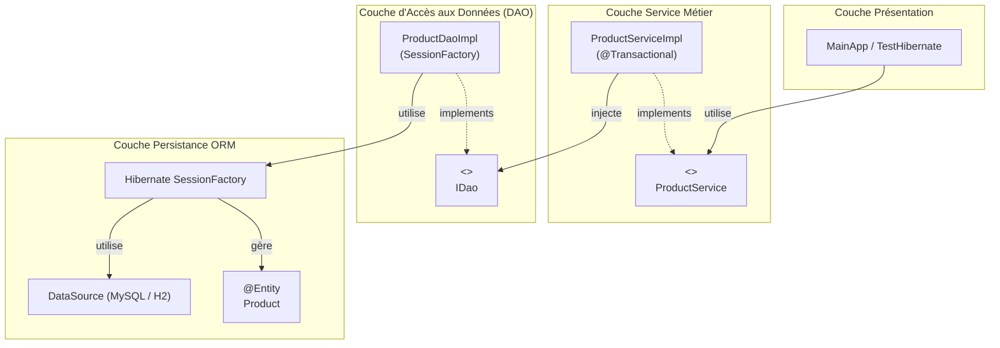

# TP 5 — Intégration de Spring Framework et Hibernate (Microservice Product)

> **ARCHITECTURE MICROSERVICES LAB**  
> Édition pédagogique : `TP5-SPRING-HIBERNATE-2026`

---

Ce laboratoire met en œuvre l'intégration complète de **Spring Framework** et de l'ORM **Hibernate 5** au sein d'un microservice de gestion de produits (`microservice-product`). Il illustre le pattern **DAO générique `<T>`**, le mapping objet-relationnel (JPA/Hibernate), et la **gestion déclarative des transactions** avec `@Transactional`.

---

## 📋 Table des matières

1. [Objectifs du TP](#-objectifs-du-tp)
2. [Architecture du microservice](#-architecture-du-microservice)
3. [Structure du projet](#-structure-du-projet)
4. [Détail des composants implémentés](#-détail-des-composants-implémentés)
   - [1. Entité JPA Product](#1-entité-jpa-product)
   - [2. Pattern DAO Générique <T>](#2-pattern-dao-générique-t)
   - [3. Implémentation DAO avec SessionFactory](#3-implémentation-dao-avec-sessionfactory)
   - [4. Configuration DataSource et SessionFactory](#4-configuration-datasource-et-sessionfactory)
   - [5. Gestion déclarative des transactions](#5-gestion-déclarative-des-transactions)
   - [6. Couche Service avec règles métier](#6-couche-service-avec-règles-métier)
5. [Compilation et exécution](#-compilation-et-exécution)
6. [Tests d'intégration](#-tests-dintégration)

---

## 🎯 Objectifs du TP

- Structurer un projet microservice Maven avec Spring ORM et Hibernate Core.
- Mettre en œuvre le pattern DAO avec typage générique `<T>`.
- Configurer une source de données relationnelle (MySQL 8 / H2 in-memory).
- Éliminer le code de gestion manuelle des transactions en utilisant `@Transactional`.
- Valider le fonctionnement via des tests d'intégration automatisés.

---

## 📐 Architecture du microservice



---

## 📁 Structure du projet

```text
TP 5/
├── pom.xml                                      # Dépendances Maven (spring-orm, hibernate-core, mysql, h2, junit)
├── README.md                                    # Documentation complète du TP
├── .project / .classpath / .gitignore           # Métadonnées Eclipse et Git
└── src/
    ├── main/
    │   ├── java/
    │   │   └── com/microservice/product/
    │   │       ├── entity/
    │   │       │   └── Product.java             # Entité JPA (@Entity, @Table(name="products"))
    │   │       ├── dao/
    │   │       │   ├── IDao.java                # Interface DAO générique IDao<T>
    │   │       │   └── ProductDaoImpl.java      # Implémentation DAO avec SessionFactory
    │   │       ├── service/
    │   │       │   ├── ProductService.java      # Interface Service métier
    │   │       │   └── ProductServiceImpl.java  # Implémentation du service avec @Transactional
    │   │       ├── config/
    │   │       │   ├── AppConfig.java           # Scan des composants (@ComponentScan)
    │   │       │   ├── HibernateConfig.java     # Configuration DataSource et LocalSessionFactoryBean
    │   │       │   └── TransactionConfig.java   # Configuration du TransactionManager (@EnableTransactionManagement)
    │   │       ├── TestHibernate.java           # Test d'initialisation du contexte Spring
    │   │       └── MainApp.java                 # Scénario complet d'ajout et consultation
    │   └── resources/
    │       └── application.properties           # Configuration DataSource MySQL (prod_db)
    └── test/
        ├── java/
        │   └── com/microservice/product/
        │       └── ProductServiceTest.java      # Tests d'intégration automatisés (Spring Test + JUnit 4)
        └── resources/
            └── application.properties           # Configuration H2 in-memory pour les tests
```

---

## 🛠️ Détail des composants implémentés

### 1. Entité JPA Product
```java
@Entity
@Table(name = "products")
public class Product {
    @Id
    @GeneratedValue(strategy = GenerationType.IDENTITY)
    private Long id;

    @Column(nullable = false)
    private String name;

    @Column(nullable = false)
    private double price;
    // Constructeurs, getters, setters
}
```

### 2. Pattern DAO Générique `<T>`
L'interface [`IDao<T>`](file:///z:/JEE%20architecture%20micro%20service/Architecture%20Microservices/TP%205/src/main/java/com/microservice/product/dao/IDao.java) factorise les opérations CRUD réutilisables :
- `void save(T entity)`
- `void update(T entity)`
- `void delete(T entity)`
- `T findById(Long id)`
- `List<T> findAll()`

### 3. Gestion déclarative des transactions
Dans [`TransactionConfig.java`](file:///z:/JEE%20architecture%20micro%20service/Architecture%20Microservices/TP%205/src/main/java/com/microservice/product/config/TransactionConfig.java) :
```java
@Configuration
@EnableTransactionManagement(proxyTargetClass = true)
public class TransactionConfig {
    @Bean
    public HibernateTransactionManager transactionManager(SessionFactory sessionFactory) {
        HibernateTransactionManager txManager = new HibernateTransactionManager();
        txManager.setSessionFactory(sessionFactory);
        return txManager;
    }
}
```

Dans [`ProductServiceImpl.java`](file:///z:/JEE%20architecture%20micro%20service/Architecture%20Microservices/TP%205/src/main/java/com/microservice/product/service/ProductServiceImpl.java) :
- Les méthodes d'écriture sont annotées `@Transactional`.
- Les méthodes de lecture seule sont annotées `@Transactional(readOnly = true)`.
- Une validation métier interdit les prix négatifs (`throw new IllegalArgumentException(...)`).

---

## 🚀 Compilation et exécution

### 1. Exécuter les tests automatisés (avec base H2 in-memory) :
```powershell
mvn clean test
```
*Exécute l'ensemble des scénarios CRUD et de validation avec 100% de succès.*

### 2. Exécuter l'application principale :
```powershell
mvn exec:java "-Dexec.mainClass=com.microservice.product.MainApp"
```

### 3. Exécuter le test de connexion Hibernate :
```powershell
mvn exec:java "-Dexec.mainClass=com.microservice.product.TestHibernate"
```

---

<div align="center">

`ARCHITECTURE MICROSERVICES LAB · TP5-SPRING-HIBERNATE-2026`

*Maîtriser la persistance relationnelle avec Spring ORM et Hibernate.*

</div>
